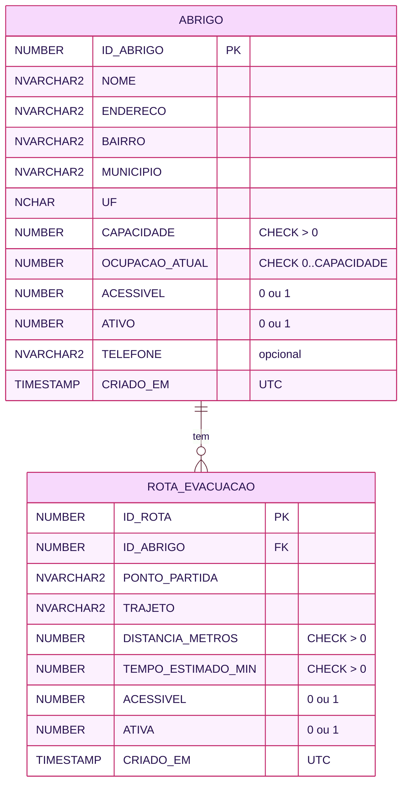

# Sinaliza.ai · Abrigos e Rotas de Evacuação (API .NET)

Global Solution 2026/2 · FIAP · 2º ano de Análise e Desenvolvimento de Sistemas
Disciplina: **Advanced Business Development with .NET**

## Integrantes

| Nome | RM | Turma |
|---|---|---|
| _preencher_ | RM_____ | _____ |
| _preencher_ | RM_____ | _____ |
| _preencher_ | RM_____ | _____ |

## A solução

**Problema.** Com o El Niño, a previsão é de chuva acima do normal até janeiro, com enchentes nas cidades.
Quando a água sobe, quem mais sofre para sair de casa a tempo são idosos, pessoas com deficiência e
moradores de áreas de risco, que muitas vezes não sabem **para onde ir** nem **por qual caminho seguro**.

**Solução do grupo: Sinaliza.ai.** Um semáforo inteligente com *modo enchente*: um sensor mede o nível da água no
cruzamento, alertas da Defesa Civil mudam o modo do semáforo e, na evacuação, os semáforos abrem em
sequência (*onda verde*) até o abrigo mais próximo. O app avisa o cidadão e mostra a rota.

**Esta API** é a parte da solução que cuida dos **abrigos** e das **rotas de evacuação**:

- cadastra os abrigos (escola, ginásio...) com capacidade, ocupação atual e acessibilidade;
- cadastra as rotas seguras de cada cruzamento até um abrigo, marcando as acessíveis (sem escada,
  com calçada rebaixada) e desativando as que alagaram;
- responde ao app quais abrigos ainda têm vaga (`GET /api/abrigos?apenasComVagas=true`) e quais rotas
  acessíveis levam até eles (`GET /api/rotas-evacuacao?apenasAcessiveis=true`).

**Cidadão beneficiado:** moradores de áreas de risco de enchente, em especial idosos e pessoas com deficiência.
**ODS:** 11 (cidades sustentáveis), 13 (ação contra a mudança do clima), 10 (redução das desigualdades), 3 (saúde e bem-estar).

## Tecnologias

- ASP.NET Core 8 (Web API com controllers)
- Entity Framework Core 8 com o provider Oracle (`Oracle.EntityFrameworkCore`)
- Oracle da FIAP (`oracle.fiap.com.br`), tabelas criadas **só por Migrations**
- Swagger UI para testar (opcional, ajuda na demonstração)

## Modelo de dados

Um **ABRIGO** tem várias **ROTA_EVACUACAO** (relação **1:N**). Ao apagar um abrigo, as rotas dele são
apagadas junto (`ON DELETE CASCADE`).



## Estrutura do projeto

```
Controllers/     AbrigosController, RotasEvacuacaoController (as rotas HTTP)
Data/            AppDbContext (mapeamento das tabelas Oracle)
Dtos/            o que entra (Request, com validação) e o que sai (Response)
Erros/           formato único de erro em JSON
Migrations/      migrations versionadas do EF Core
Models/          entidades Abrigo e RotaEvacuacao
scripts/         SELECTs para conferir os dados no Oracle
CitizenTech.Abrigos.http   todas as requisições de teste, prontas
```

## Como executar

### 1. Pré-requisitos

- [.NET 8 SDK](https://dotnet.microsoft.com/download/dotnet/8.0)
- Usuário e senha do Oracle da FIAP

### 2. Baixar e restaurar

```bash
git clone https://github.com/rhayssagraziano/sinaliza-ai-dotnet.git
cd sinaliza-ai-dotnet
dotnet tool restore      # instala o dotnet-ef 8 deste projeto (dotnet-tools.json)
```

### 3. Configurar a conexão com o Oracle (fora do repositório)

A senha **não** está no código. `appsettings.json` tem a connection string vazia de propósito.
Configure com o *user-secrets* do .NET, que guarda o valor no seu usuário do Windows/Linux, fora da pasta do projeto:

```bash
dotnet user-secrets set "ConnectionStrings:Oracle" "User Id=SEU_RM;Password=SUA_SENHA;Data Source=oracle.fiap.com.br:1521/ORCL"
```

Alternativa (container, VM ou CI): variável de ambiente `ConnectionStrings__Oracle` com o mesmo valor.

### 4. Criar as tabelas no Oracle (Migrations)

```bash
dotnet tool run dotnet-ef database update
```

Cria `ABRIGO`, `ROTA_EVACUACAO` e `__EFMigrationsHistory` no seu usuário do Oracle.

### 5. Subir a API

```bash
dotnet run
```

A API sobe em **http://localhost:5080** e abre o Swagger em **http://localhost:5080/swagger**.

## Como testar

Pelo **Swagger** (`/swagger`) ou pelo arquivo [`CitizenTech.Abrigos.http`](CitizenTech.Abrigos.http)
(no VS Code, com a extensão *REST Client*), que tem todas as chamadas abaixo prontas, na ordem.

### Rotas

| Método | Rota | Sucesso | Erros |
|---|---|---|---|
| GET | `/api/abrigos` (filtros `municipio`, `apenasComVagas`) | 200 | |
| GET | `/api/abrigos/{id}` (abrigo + rotas) | 200 | 404 |
| GET | `/api/abrigos/{id}/rotas` | 200 | 404 |
| POST | `/api/abrigos` | 201 | 400 |
| PUT | `/api/abrigos/{id}` | 204 | 400, 404 |
| DELETE | `/api/abrigos/{id}` | 204 | 404 |
| GET | `/api/rotas-evacuacao` (filtros `abrigoId`, `apenasAcessiveis`) | 200 | |
| GET | `/api/rotas-evacuacao/{id}` | 200 | 404 |
| POST | `/api/rotas-evacuacao` | 201 | 400 |
| PUT | `/api/rotas-evacuacao/{id}` | 204 | 400, 404 |
| DELETE | `/api/rotas-evacuacao/{id}` | 204 | 404 |

### Exemplo: cadastrar um abrigo

```http
POST /api/abrigos
Content-Type: application/json

{
  "nome": "EMEF Exemplo do Centro",
  "endereco": "Rua Exemplo, 100",
  "bairro": "Centro",
  "municipio": "São Paulo",
  "uf": "SP",
  "capacidade": 250,
  "ocupacaoAtual": 40,
  "acessivel": true
}
```

Resposta **201 Created**, com o cabeçalho `Location: /api/abrigos/1` e o abrigo criado no corpo.

### Erros tratados

Todo erro volta em JSON, no mesmo formato:

```json
{ "status": 400, "erro": "Dados inválidos.", "detalhes": { "ocupacaoAtual": ["A ocupação atual não pode ser maior que a capacidade."] } }
```

| Situação | Status |
|---|---|
| Campo obrigatório vazio, UF com mais de 2 letras, capacidade 0, distância negativa... | 400 |
| Ocupação atual maior que a capacidade | 400 |
| Rota para um abrigo que não existe (`abrigoId` inválido) | 400 |
| Corpo que não é JSON válido | 400 |
| `id` que não existe em GET, PUT ou DELETE | 404 |
| Operação que viola uma regra do banco | 409 |

As regras de capacidade, distância e tempo também existem no banco, como `CHECK` constraints criadas
pela Migration: o dado fica correto mesmo se alguém gravar direto pelo SQL.

### Conferir no Oracle

Depois do CRUD, rode [`scripts/consultas-oracle.sql`](scripts/consultas-oracle.sql) no SQL Developer
para ver os registros, a relação 1:N e as constraints.

## Relação com as outras entregas

- **Mobile (Flutter):** o app mostra ao cidadão os abrigos com vaga e as rotas acessíveis.
- **DevOps:** esta API pode ser a aplicação que roda em container na VM Azure. A connection string
  entra pela variável de ambiente `ConnectionStrings__Oracle`.
- **Banco (PL/SQL):** os cruzamentos, alertas e leituras do sensor ficam em outras tabelas do mesmo modelo.

## Uso de IA generativa

- **Claude Code (Anthropic):** apoio para montar a estrutura inicial do projeto, sugerir o mapeamento do
  EF Core para o Oracle e escrever o README. Todo o código foi revisado, executado e testado pelo grupo,
  que sabe explicar cada parte (rota, controller, DbContext e resposta HTTP).
