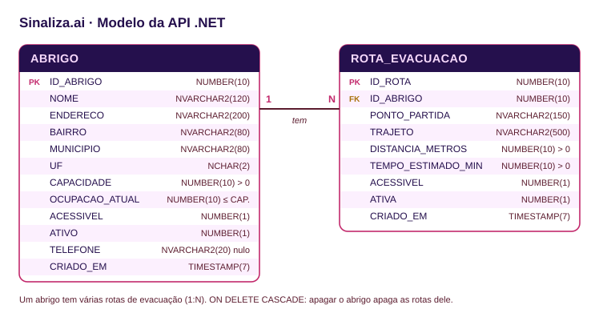

# Sinaliza.ai · Abrigos e Rotas de Evacuação (API .NET)

Global Solution 2026/2 · FIAP · 2º ano de Análise e Desenvolvimento de Sistemas
Disciplina: **Advanced Business Development with .NET**

## Integrantes

- Julia Valerio Guimarães da Silva
- Rhayssa Graziano Bernardes e Rocha Ferreira
- Ruan Lima da Silva

## A solução

**Problema.** O semáforo comum trata todo mundo igual: idosos e pessoas com deficiência não conseguem
atravessar no tempo do verde, e o ciclo não muda quando a rua alaga. Com o El Niño, a previsão é de chuva
acima do normal, com enchentes nas cidades. Quando é preciso sair de casa, muita gente não sabe **para onde
ir** nem **por qual caminho seguro**.

**Solução do grupo: Sinaliza.ai.** Um semáforo inteligente de travessia que **prioriza o pedestre** e muda de
modo conforme o risco climático. O risco vem de três fontes: a previsão do El Niño (contexto), os alertas
oficiais da Defesa Civil e um sensor de nível de água no próprio cruzamento.

| Modo | Gatilho | O que o semáforo faz |
|---|---|---|
| `NORMAL` | nenhum | o pedestre parado na faixa pede a travessia; verde mínimo para os carros |
| `ATENCAO` | alerta amarelo ou chuva forte prevista | espera menor para o pedestre e travessia mais longa |
| `ALAGAMENTO` | sensor acima do limite | amarelo piscante, buzzer e travessia bloqueada; o app sugere outra rota |
| `EVACUACAO` | alerta severo da Defesa Civil | onda verde em sequência **até o abrigo** |

A câmera só **conta** pessoas e veículos: não há reconhecimento facial e nenhuma imagem é guardada.

**Esta API** é a parte da solução que cuida do modo `EVACUACAO`: os **abrigos** e as **rotas de evacuação**:

- cadastra os abrigos (escola, ginásio...) com capacidade, ocupação atual e acessibilidade;
- cadastra as rotas seguras de cada cruzamento até um abrigo, marcando as acessíveis (sem escada,
  com calçada rebaixada) e desativando as que alagaram;
- responde ao app quais abrigos ainda têm vaga (`GET /api/abrigos?apenasComVagas=true`) e quais rotas
  acessíveis levam até eles (`GET /api/rotas-evacuacao?apenasAcessiveis=true`).

**Cidadão beneficiado:** pedestres, em especial idosos e pessoas com deficiência, que precisam de mais tempo
de travessia e de rotas sem escada; motoristas; e moradores de áreas sujeitas a alagamento.

**ODS:** 11 (cidades e comunidades sustentáveis), 13 (ação contra a mudança global do clima),
9 (indústria, inovação e infraestrutura) e 3 (saúde e bem-estar, pela segurança viária).

## Tecnologias

- ASP.NET Core 8 (Web API com controllers)
- Entity Framework Core 8 com o provider Oracle (`Oracle.EntityFrameworkCore`)
- Oracle da FIAP (`oracle.fiap.com.br`), tabelas criadas **só por Migrations**
- Swagger UI para testar (opcional, ajuda na demonstração)

## Modelo de dados

Um **ABRIGO** tem várias **ROTA_EVACUACAO** (relação **1:N**). Ao apagar um abrigo, as rotas dele são
apagadas junto (`ON DELETE CASCADE`). As regras de capacidade, distância e tempo também são `CHECK`
constraints no banco.



## Estrutura do projeto

```
Controllers/     AbrigosController, RotasEvacuacaoController (as rotas HTTP)
Data/            AppDbContext (mapeamento das tabelas Oracle)
Dtos/            o que entra (Request, com validação) e o que sai (Response)
Erros/           formato único de erro em JSON
Migrations/      migrations versionadas do EF Core
Models/          entidades Abrigo e RotaEvacuacao
scripts/         SELECTs para conferir os dados no Oracle
CitizenTech.Abrigos.http   todas as requisições de teste, prontas
```

## Como executar

### 1. Pré-requisitos

- [.NET 8 SDK](https://dotnet.microsoft.com/download/dotnet/8.0)
- Usuário e senha do Oracle da FIAP

### 2. Baixar e restaurar

```bash
git clone https://github.com/rhayssagraziano/sinaliza-ai-dotnet.git
cd sinaliza-ai-dotnet
dotnet tool restore      # instala o dotnet-ef 8 deste projeto (dotnet-tools.json)
```

### 3. Configurar a conexão com o Oracle (fora do repositório)

A senha **não** está no código. `appsettings.json` tem a connection string vazia de propósito.
Configure com o *user-secrets* do .NET, que guarda o valor no seu usuário do Windows/Linux, fora da pasta do projeto:

```bash
dotnet user-secrets set "ConnectionStrings:Oracle" "User Id=SEU_RM;Password=SUA_SENHA;Data Source=oracle.fiap.com.br:1521/ORCL"
```

Alternativa (container, VM ou CI): variável de ambiente `ConnectionStrings__Oracle` com o mesmo valor.

### 4. Criar as tabelas no Oracle (Migrations)

```bash
dotnet tool run dotnet-ef database update
```

Cria `ABRIGO`, `ROTA_EVACUACAO` e `__EFMigrationsHistory` no seu usuário do Oracle.

### 5. Subir a API

```bash
dotnet run
```

A API sobe em **http://localhost:5080** e abre o Swagger em **http://localhost:5080/swagger**.

## Como testar

Pelo **Swagger** (`/swagger`) ou pelo arquivo [`CitizenTech.Abrigos.http`](CitizenTech.Abrigos.http)
(no VS Code, com a extensão *REST Client*), que tem todas as chamadas abaixo prontas, na ordem.

### Rotas

| Método | Rota | Sucesso | Erros |
|---|---|---|---|
| GET | `/api/abrigos` (filtros `municipio`, `apenasComVagas`) | 200 | |
| GET | `/api/abrigos/{id}` (abrigo + rotas) | 200 | 404 |
| GET | `/api/abrigos/{id}/rotas` | 200 | 404 |
| POST | `/api/abrigos` | 201 | 400 |
| PUT | `/api/abrigos/{id}` | 204 | 400, 404 |
| DELETE | `/api/abrigos/{id}` | 204 | 404 |
| GET | `/api/rotas-evacuacao` (filtros `abrigoId`, `apenasAcessiveis`) | 200 | |
| GET | `/api/rotas-evacuacao/{id}` | 200 | 404 |
| POST | `/api/rotas-evacuacao` | 201 | 400 |
| PUT | `/api/rotas-evacuacao/{id}` | 204 | 400, 404 |
| DELETE | `/api/rotas-evacuacao/{id}` | 204 | 404 |

### Exemplo: cadastrar um abrigo

```http
POST /api/abrigos
Content-Type: application/json

{
  "nome": "EMEF Exemplo do Centro",
  "endereco": "Rua Exemplo, 100",
  "bairro": "Centro",
  "municipio": "São Paulo",
  "uf": "SP",
  "capacidade": 250,
  "ocupacaoAtual": 40,
  "acessivel": true
}
```

Resposta **201 Created**, com o cabeçalho `Location: /api/abrigos/1` e o abrigo criado no corpo.

### Erros tratados

Todo erro volta em JSON, no mesmo formato:

```json
{ "status": 400, "erro": "Dados inválidos.", "detalhes": { "ocupacaoAtual": ["A ocupação atual não pode ser maior que a capacidade."] } }
```

| Situação | Status |
|---|---|
| Campo obrigatório vazio, UF com mais de 2 letras, capacidade 0, distância negativa... | 400 |
| Ocupação atual maior que a capacidade | 400 |
| Rota para um abrigo que não existe (`abrigoId` inválido) | 400 |
| Corpo que não é JSON válido | 400 |
| `id` que não existe em GET, PUT ou DELETE | 404 |
| Operação que viola uma regra do banco | 409 |

As regras de capacidade, distância e tempo também existem no banco, como `CHECK` constraints criadas
pela Migration: o dado fica correto mesmo se alguém gravar direto pelo SQL.

### Conferir no Oracle

Depois do CRUD, rode [`scripts/consultas-oracle.sql`](scripts/consultas-oracle.sql) no SQL Developer
para ver os registros, a relação 1:N e as constraints.

## Relação com as outras entregas

- **Java (API principal):** cuida dos cruzamentos, leituras e alertas e decide o modo do semáforo. Quando o
  modo vira `EVACUACAO`, o app busca nesta API o abrigo e a rota.
- **Mobile (Flutter):** o app mostra ao cidadão os abrigos com vaga e as rotas acessíveis.
- **DevOps:** o professor aceita a API em Java ou .NET no container da VM Azure. Se esta for a escolhida,
  a connection string entra pela variável de ambiente `ConnectionStrings__Oracle`.
- **Banco (PL/SQL):** os cruzamentos, alertas, parâmetros dos modos e leituras do sensor ficam em outras
  tabelas do mesmo modelo, no mesmo usuário Oracle (os nomes não se repetem).
